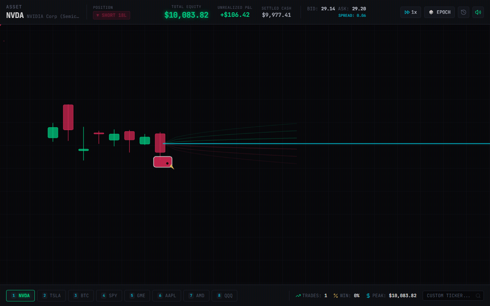

# 🐂 BULLIMIA // Quantitative Trading Autoscroller 🐻

> *"From retail chart surfer to institutional market maker."*

[](https://github.com/awei55/bullimia)
[](https://svelte.dev)
[](https://tauri.app)
[](https://fastapi.tiangolo.com)
[]()

---

## 🎮 What is Bullimia?

**Bullimia** is a hybrid quantitative trading simulator and 2D rhythm autoscroller built on genuine historical financial market candlestick terrain. 

You control the twin forces of Wall Street:
- **The Bull (Long)**: Gallops across the **upper wicks and green candle bodies** (buying at Ask, mark-to-market at Bid).
- **The Bear (Short)**: Hangs upside-down beneath **lower wicks and red drops** (selling at Bid, mark-to-market at Ask).
- **Neutral Cash (100% Cash)**: Press `SPACE + ESC` to flatten all open positions and wait for optimal market setups.

The game starts as a binary-options directional rhythm tutorial ($10,000 to $1,000,000) and evolves across four grand horizons into an institutional quantitative trading simulator:
1. **Phase 1: Retail Arcade Tutorial** ($10,000 $\rightarrow$ $1,000,000$)
2. **Phase 2: Independent Prop Trader** ($1,000,000 $\rightarrow$ $10,000,000$)
3. **Phase 3: Quantitative Hedge Fund & Algorithmic Studio** ($10,000,000 $\rightarrow$ $100,000,000$)
4. **Phase 4: Institutional Endgame & Sovereign Credit** ($100,000,000+$)

---

## 📸 Flagship WebGL Engine



### Core Visual & Audio Features
- **Fog of War**: Candlesticks ahead of the player are obscured in darkness; price is revealed only as the player progresses through time.
- **Bid/Ask Spread Corridor**: Radiant glowing cyan laser projecting into the future, with corridor thickness proportional to live spread.
- **Monte Carlo Volatility Surfaces**: Cycling stochastic trajectory cones projecting the probability fan ($\pm 1\sigma$, $\pm 2\sigma$) of where price can go based on asset ATR.
- **MT5 Trade Trails**: Green and red dashed lines connecting historical entry and exit points with profit/loss badges.
- **Responsive Synthwave Soundtrack**: Procedural Web Audio engine that shifts BPM from 118 to 150 BPM under large lot sizes, adding tension dissonances when in negative PnL and melodic chimes on profits.

---

## 🚀 Rapid Build & Test Pipeline

```bash
# 1. Install dependencies
npm install

# 2. Run the unified test suite (Backend Pytest + Frontend Vitest)
npm test

# 3. Run individual test suites
npm run test:backend   # 11 Quant Kernel & API tests in 1.5s
npm run test:frontend  # 4 Vitest store & lot calculation tests in 1.6s

# 4. Run automated headless Playwright browser verification
python tests/test_e2e_playwright.py

# 5. Launch development environment (Vite HMR + FastAPI Backend)
npm run dev

# 6. Build production WebGL bundle
npm run build
```

---

## 🏛️ Project Architecture

```
minigames/
├── backend/                         # Layer 1: Deterministic Financial & Quant Kernel
│   ├── bullimia_quant/
│   │   ├── kernel.py                # Pure accounting (PnL, margin, lots, commissions, solvency)
│   │   └── streaming.py             # Historical replay fabric & logarithmic ATR scaler
│   ├── server.py                    # Local FastAPI + WebSocket streaming engine (port 8000)
│   └── tests/                       # Pytest test suite (11 passing tests)
├── src/                             # Layer 3 & 4: Svelte 5 + PixiJS 8 Front-End
│   ├── App.svelte                   # Main application layout & keyboard controls
│   ├── lib/
│   │   ├── engine/pixi_game.ts      # Hardware-accelerated WebGL autoscroller & particles
│   │   ├── audio/soundtrack.ts      # Responsive procedural synthwave audio synthesizer
│   │   ├── stores/trading.ts        # Reactive trading state & WebSocket sync
│   │   └── components/              # HUD, AssetTickerBar, TradeLogModal, GameOverModal
├── src-tauri/                       # Desktop Native Shell (Tauri v2)
│   ├── tauri.conf.json              # 1280x800 desktop workstation window config
│   └── Cargo.toml
├── data/                            # Deep 5-year historical datasets (NVDA, TSLA, BTC, SPY, etc.)
├── docs/                            # Roadmaps & Architectural Specifications
│   ├── GRAND_VISION_ROADMAP.md      # Multi-phase progression master blueprint
│   └── SYSTEM_ARCHITECTURE.md      # Decoupled 5-layer modular architectural specification
└── loop-demo/                       # Phase 1 Prototype Archive (Pygame & HTML5 Canvas)
```

---

## 🕹️ Controls

| Key | Action | Function |
| :--- | :--- | :--- |
| **SPACE (Tap)** | Quick Flip | Reverses position instantly (Bull $\leftrightarrow$ Bear) with a 1-lot order. |
| **SPACE (Hold & Release)** | Charge Order Size | Charges lots from 1 to 100 with escalating character vibration and badge counter. |
| **SPACE + ESC** | Neutral Flatten | Closes active position to **100% Cash** without entering an opposing trade. |
| **1 - 8** | Seamless Asset Switch | Switches to NVDA, TSLA, BTC-USD, SPY, GME, AAPL, AMD, or QQQ. |
| **T** | Jump Historical Epoch | Drops into a random historical era from the asset's deep history. |
| **M** | Toggle Audio | Mutes / unmutes the procedural synthwave soundtrack. |
| **R** | Restart Career | Resets capital to $10,000 USD after a Margin Call. |
