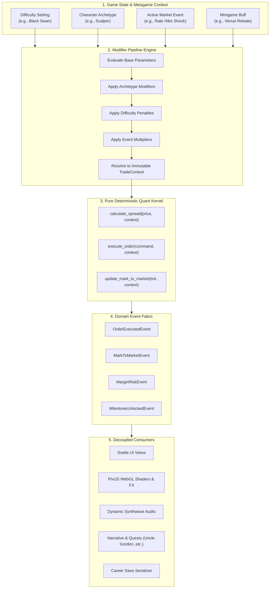

# 🏛️ BULLIMIA ARCHITECTURAL MANIFESTO: Domain Decoupling & Metagame Extensibility

> **Document Status**: Definitive & Locked  
> **Target Audience**: Core Game Engineers, Systems Designers, Quantitative Modelers  
> **Core Principle**: *The Quant Kernel is an immutable, headless financial simulation. Characters, difficulties, market events, and minigames never modify financial math; they compose as layered modifiers and event listeners.*

---

## 1. Executive Summary: The Decoupling Guarantee

In Bullimia, the financial accounting engine (Layer 1) is **strictly decoupled** from UI rendering, WebGL graphics, user inputs, and narrative triggers.

### The Inviolable Separation
```
+-----------------------------------------------------------------------------------+
|                            METAGAME & PRESENTATION LAYER                          |
|  [ Svelte 5 Views ]   [ PixiJS 8 Autoscroller ]   [ Sound Engine ]   [ Narrative ] |
+-----------------------------------------------------------------------------------+
                                         |
                                         | Dispatches Commands / Subscribes to Events
                                         v
+-----------------------------------------------------------------------------------+
|                        MODIFIER PIPELINE & EVENT FABRIC                           |
|  [ Difficulty Profiles ]  [ Character Archetypes ]  [ Dynamic Events ]  [ Minigames ]|
+-----------------------------------------------------------------------------------+
                                         |
                                         | Evaluates Effective Trade Context
                                         v
+-----------------------------------------------------------------------------------+
|                        DETERMINISTIC QUANT ENGINE (HEADLESS)                       |
|   Pure Double-Entry Accounting  |  Margin Constraints  |  Mark-to-Market Solvency  |
+-----------------------------------------------------------------------------------+
```

1. **The Quant Kernel (`QuantKernel` in Python / `quantMath` in TypeScript)** knows nothing about:
   - DOM elements, HTML nodes, CSS classes, or screen coordinates.
   - PixiJS stages, sprites, particle emitters, or WebGL shaders.
   - Audio contexts, synth oscillators, or volume sliders.
   - Characters, dialogue trees, narrative benefactors, or minigame puzzles.
2. **The Quant Kernel ONLY knows**:
   - `AccountState`: Cash balance, floating equity, open side, open lots, entry price, margin used, high watermark.
   - `OrderCommand`: Ticker, desired side (`BULL`, `BEAR`, `FLAT`), lots, current tick price, timestamp.
   - `TradeContext`: Evaluated parameters (effective spread, commission per lot, margin rate, leverage multiplier, slippage offset).
   - `TradeRecord`: Output ledger of closed trades, realized PnL, win/loss status.

---

## 2. Industry Analysis: How Great Games Solve This

When building complex simulation-heavy, economy-driven games (such as *EVE Online*, *SimCity*, *Factorio*, *Offworld Trading Company*, or RPG stat systems in *Path of Exile*), developers historically encountered the **"Spaghetti Trap"**: hardcoding game mechanics (e.g. `if player == 'WARRIOR' then discount = 0.1`) directly inside the core simulation. Within months, modifying a single feature broke five others.

To avoid this, the game industry developed three foundational patterns that Bullimia formally adopts:

### Pattern A: Hexagonal / Ports & Adapters Architecture (Domain Isolation)
* **Used by**: *EVE Online*, high-frequency trading simulators, enterprise financial engines.
* **Mechanism**: The domain logic (double-entry ledger, PnL equations, margin call math) sits inside a sealed hexagonal boundary. The outside world communicates exclusively through:
  - **Inbound Ports (Commands)**: `submit_order(command)`, `mark_to_market(tick)`.
  - **Outbound Ports (Domain Events)**: `on_order_filled(event)`, `on_margin_warning(event)`, `on_position_liquidated(event)`.
* **Benefit**: The domain simulation can be run in headless unit test suites, replays, or server clusters without a single frame of graphics or UI loaded.

### Pattern B: The Modifier Pipeline / "Stat Stack" Pattern
* **Used by**: *Path of Exile*, *World of Warcraft*, *Civilization VI*.
* **Mechanism**: The core calculation formula is fixed and immutable:
  $$\text{Realized PnL} = (\text{Exit Price} - \text{Entry Price}) \times \text{Lots} \times \text{Multiplier} - \text{Commissions}$$
  $$\text{Effective Fee} = \text{Base Fee} \times \prod (1 - \text{Discounts}) + \sum \text{Surcharges}$$
* Rather than the engine querying "Who is the player?", the outer gameplay system evaluates all active sources (character passives, difficulty settings, temporary market event curses, minigame buffs) into a single resolved **`TradeContext`** and passes it to the engine.
* **Benefit**: Adding 50 new characters, 10 difficulty tiers, and 20 minigames requires **zero modifications** to the core accounting formulas.

### Pattern C: Event-Driven Metagame Fabric (Pub/Sub)
* **Used by**: *SimCity*, *Crusader Kings III*, modern game engines (Unreal/Unity Event Buses).
* **Mechanism**: Metagame subsystems (Quests, Narrative Characters like Uncle Gordon, Steam Achievements, Procedural Sound Engines) **listen** to the stream of domain events.
  - When the engine emits `EquityChangedEvent(new_equity = 5200.0)`, the Narrative System independently detects that the `$5,000` benefactor trigger has been met and pauses the game to show Uncle Gordon.
  - The Quant Kernel **never calls Uncle Gordon directly**. Uncle Gordon merely subscribes to the engine's event broadcast.

---

## 3. Bullimia's Extensibility Blueprint

Here is how upcoming features plug cleanly into the decoupled architecture:



---

## 4. Concrete Interface Contracts

### 4.1 The Immutable `TradeContext` (Passed into Kernel)
```typescript
export interface TradeContext {
  // Calibration
  contractMultiplier: number;     // e.g. 10.0 ($10/pt)
  marginRate: number;             // e.g. 0.02 (50:1 leverage)
  maintenanceMarginRate: number;  // e.g. 0.50 (liquidation at 50% maintenance)

  // Evaluated Modifiers
  effectiveSpreadMultiplier: number; // 1.0 = base, 2.5 = flash crash, 0.7 = co-location
  commissionPerLot: number;          // e.g. $1.00 base, $0.50 for Floor Veteran
  slippageTicks: number;             // 0 for ultra-liquid, >0 in low-liquidity environments
  marginInterestDailyRate: number;   // 0.0 before $10M, debt interest after $10M

  // Solvency Overrides
  godMode: boolean;                  // Suppresses liquidations during sandbox/dev testing
}
```

### 4.2 The Modifier Interfaces
```typescript
// 1. Difficulty Profile
export interface DifficultyProfile {
  id: 'retail_amateur' | 'prop_trader' | 'macro_fund_manager' | 'black_swan_hunter';
  name: string;
  spreadMultiplier: number;      // 0.8x for beginner, up to 3.0x for black swan
  commissionRate: number;        // $0.50 to $5.00 / lot
  leverageCap: number;           // 100:1 (Novice) down to 5:1 (Ultra Hardcore)
  slippageProbability: number;   // 0.0 to 0.35
}

// 2. Character Archetype (Perks & Penalties)
export interface CharacterArchetype {
  id: string;
  name: string;
  title: string;
  bio: string;
  modifiers: {
    commissionDiscountPct?: number;   // e.g. 0.30 (30% cheaper trades)
    spreadReductionPct?: number;       // e.g. 0.15 (15% tighter spread)
    speedDilationMax?: number;         // e.g. 5x for Speed Scalper
    newsLeadCandles?: number;          // e.g. 5 candles early warning instead of 3
    marginBufferPct?: number;          // e.g. 0.10 (10% extra margin tolerance)
  };
}

// 3. Dynamic Market Event
export interface MarketEvent {
  id: string;
  headline: string;
  severity: 'INFO' | 'WARNING' | 'CRITICAL';
  durationCandles: number;
  modifiers: {
    spreadMultiplier?: number;         // e.g. 3.0x during FOMC announcement
    volatilityMultiplier?: number;     // e.g. 2.5x ATR
    forcedOrderDirection?: 'BULL' | 'BEAR' | null;
  };
}

// 4. Minigame Rewards & Buffs
export interface MinigameReward {
  id: string;
  name: string;
  durationSeconds: number;
  rewardType: 'CASH_BOUNTY' | 'TEMPORARY_BUFF' | 'INFRASTRUCTURE_LICENSE';
  cashAmount?: number;
  modifiers?: {
    zeroCommissions?: boolean;
    darkPoolExecution?: boolean;       // Zero spread for next 60 seconds
  };
}
```

---

## 5. Architectural Commandments & Verification Rules

To maintain this decoupling across the entire lifecycle of Bullimia:

1. **Rule 1: Zero Presentation in Kernel**
   - The Quant Kernel must never import Svelte, PixiJS, HTML, Web Audio, or Tauri APIs.
   - Any commit adding visual or sound logic into `bullimia_quant` or core financial math is rejected immediately.
2. **Rule 2: Zero Math Duplication in Views**
   - Views (`HUD.svelte`, `TradeConsoleView.svelte`, `PixiGame.ts`) must never calculate their own PnL, equity, or margin.
   - They strictly render values emitted by the Quant Engine.
3. **Rule 3: Modifiers are Pure Functions**
   - Modifiers take a base `TradeContext` and return an updated `TradeContext`. They have zero side effects on account balances.
4. **Rule 4: Double-Entry Solvency Invariant**
   - At every tick:
     $$\text{Equity} = \text{Cash Balance} + \text{Unrealized PnL}$$
     $$\text{Free Margin} = \text{Equity} - \text{Margin Used}$$
   - Automated fuzzing tests (`backend/tests/test_kernel.py`) enforce this invariant on every build.
5. **Rule 5: Headless Testability**
   - Every financial mechanic (stops, limits, margins, interest, baskets, L2 order books) must have 100% test coverage running headlessly in Python/Vitest before any UI is authored for it.
