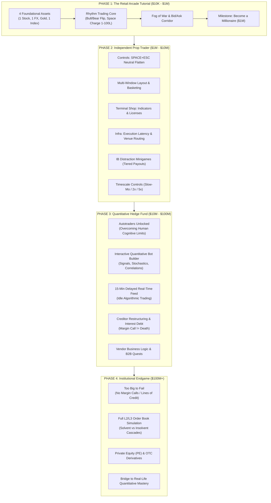

# 🐂 BULLIMIA: Grand Vision & Progression Master Blueprint 🐻

> *"From retail chart surfer to institutional market maker."*

---

## 🗺️ Architectural Progression Overview

---

## Phase 1: The Genesis Tutorial ($10,000 $\rightarrow$ $1,000,000$)
*Theme: The Survival Instinct & Primal Market Psychology*

- **Conceptual Foundation**: Gamified binary options / directional rhythm autoscroller inside historical price action.
- **The Core 4 Asset Classes**:
  1. **Stock**: e.g., NVDA / AAPL (Momentum & growth volatility)
  2. **Currency (FX)**: e.g., EUR/USD (High leverage, micro-pip spreads, macro mean-reversion)
  3. **Commodity**: Gold / XAU-USD (Safe-haven surges, inflation spikes, geopolitical flows)
  4. **Index**: S&P 500 / SPY (Global equity benchmark, persistent trends, liquidity depth)
- **Core Mechanics**:
  - Bull (Long / Top Surface) vs Bear (Short / Underside Surface).
  - Hold-to-Charge order sizing ($1 \rightarrow 100$ Lots) with violent character vibration.
  - Bid-Ask spread crossing, $1 per-lot commission, floating mark-to-market equity.
  - Fog of War: Future hidden in darkness; glowing Bid-Ask spread beam; cycling Monte Carlo volatility fans.
  - MT5-style trade connection lines (green wins, red losses) tracking performance.
- **Graduation Condition**: Reach **$1,000,000 USD** in total equity.

---

## Phase 2: Independent Prop Trader ($1,000,000 $\rightarrow$ $10,000,000$)
*Theme: Tool Mastery, Multi-Tasking & Market Architecture*

### 1. Advanced Execution & Tactical Controls
- **Neutral Position Exit (`SPACE + ESC`)**:
  - In Phase 1, space always reverses the position (Bull $\leftrightarrow$ Bear).
  - Phase 2 unlocks the professional ability to **flatten to 100% Cash** without entering an opposing position, waiting patiently for ideal setups.
- **Time Dilation Controls**:
  - **Slow-Motion (0.5x)**: Precise entry timing during violent waterfall dips or parabolic spikes.
  - **Fast-Forward (2x / 5x / 10x)**: Fast-forwarding slow consolidation regimes.
  - **Fixed Lots & Quick-Key Presets**: Bypassing charge times for instant algorithmic sizing.

### 2. Multi-Window Viewport & Basket Trading
- **Multi-Chart Tiling**:
  - Run 2, 3, or 4 simultaneous asset feeds in split panes (e.g. trading Gold and EUR/USD in parallel).
- **Basket Trading & Synthetic Pairs**:
  - Combine multiple feeds into a single synthesized relative-value spread (e.g., Long NVDA + Short AMD, or Short EUR + Long Gold).
  - Surf the spread difference as a customized synthetic candlestick world!

### 3. Terminal Shop: Capital Reinvestment & Infrastructure
- **Trading Licenses**:
  - Purchase licenses with in-game profits to unlock exotic assets: Crypto altcoins, Crude Oil (WTI), VIX volatility products, Treasury Yields.
- **Infrastructure & Latency Upgrades**:
  - Upgrade from retail internet $\rightarrow$ fiber routes $\rightarrow$ exchange colocation in Secaucus (NY4) and Chicago (CME).
  - Reduces execution latency, tightens the Bid-Ask spread, and minimizes slippage.
- **Execution Venues (ECNs vs Dark Pools vs Lit Exchanges)**:
  - Choose execution routing based on venue profiles:
    - *Lit Exchange*: Lowest latency, higher taker fees.
    - *Dark Pool*: Zero market impact for large lot sizes, but risk of non-fills.
    - *Wholesaler/Internalizer*: Sub-penny price improvement, but adverse selection on momentum.

### 4. The IB (Investment Banking / Distraction) Minigames
- Tiny cognitive micro-puzzles (deal valuation spreadsheets, compliance audit matching, regulatory filings, pitchbook formatting) that appear on screen.
- **The Psychological Trap**:
  - Solving them awards lucrative tiered cash payouts that scale with frequency.
  - *However*, your live market positions continue scrolling at full speed in the background!
  - Simulates the real trader's curse: getting distracted by busywork while a position bleeds into a margin breach.

---

## Phase 3: The Quantitative Firm & Algorithmic Era ($10,000,000 $\rightarrow$ $100,000,000$)
*Theme: Overcoming the Biological Bottleneck via Systematic Code*

### 1. Autotraders & The Bot Builder Canvas
- Players realize that manual execution across 6+ assets with millisecond shifts exceeds human cognitive limits.
- **Interactive Visual Bot Studio**:
  - Flowchart / block-based systematic strategy designer:
    - **Signals**: Moving average crossovers, RSI divergences, Bollinger squeezes, Volume Delta spikes.
    - **Stochastic Markers**: Volatility surface skew, Monte Carlo probability threshold triggers.
    - **Cross-Asset Correlations**: E.g., *"If Gold drops >1% and Dollar Index breaks resistance, short EUR/USD with 50 lots."*
  - Purchase advanced mathematical modules (Kalman filters, machine learning classifiers, cointegration engines) using firm earnings.

### 2. Real-Time 15-Minute Delayed Market Feeds (Idle Autotrading)
- Integrate a live, 15-minute delayed market data stream (from public financial APIs or broker feeds).
- Allows players to activate their custom autotrader algorithms and let them run **idly in the background** while learning the principles of automated quantitative execution.

### 3. Business Logic & Vendor Relations
- Prime brokers, liquidity providers, and software vendors offer relationship quests:
  - Provide liquidity to a troubled fund during a market freeze.
  - Route order flow to an emerging venue in exchange for negative maker fees (rebates).
  - Successful business diplomacy unlocks institutional prime brokerage borrow rates and proprietary data feeds.

### 4. Restructuring & Creditor Debt (Death by Margin Call Removed)
- After crossing $10,000,000, **Margin Call stops being instant Game Over**.
- You unlock **Multi-Venue Leveraged Margin Pooling**.
- **Creditor Restructuring**:
  - If a catastrophe wipes your pool, you enter emergency Chapter 11 / Creditor Restructuring.
  - Creditors inject rescue capital into a single pool, but charge compounding **interest payments**.
  - If margin called repeatedly before stabilizing above $10M, interest penalties compound aggressively, forcing high-stakes turnaround trading to service the debt.

---

## Phase 4: The Institutional Endgame ($100,000,000+)
*Theme: Market Making, Sovereign Credit & Becoming Too Big To Fail*

### 1. Too Big to Fail: Sovereign Lines of Credit
- Once the player crosses **$100,000,000 USD**, Margin Calls are eliminated entirely.
- Unlocks **Institutional Lines of Credit**:
  - Draw down hundreds of millions in central bank and sovereign credit facilities.
  - Trade not as a price taker, but as a **market maker** shaping market liquidity.

### 2. Level 2 / Level 3 Deep Order Book Simulation
- The game shifts from simple candlesticks into the underlying microstructure:
  - Full DOM (Depth of Market) book simulation.
  - Visualizing limit buy/sell walls, hidden iceberg orders, and spoofing liquidity.
  - Simulating solvent vs insolvent liquidation waterfalls: large market orders devour liquidity depth, causing slippage cascades across venues.

### 3. The Shadow Market: Private Equity & Bespoke OTC Derivatives
- **Side Tabs / Megacap Ecosystem**:
  - **Private Equity (PE)**: Leveraged buyouts of distressed corporate vendors, acquiring asset backlogs, restructuring balance sheets.
  - **OTC (Over-The-Counter) Trading**: Crafting bespoke bilateral exotic contracts (volatility swaps, barrier options, catastrophe bonds) with counterparties.
- **The Ultimate Meta-Goal**:
  - Bridges the player from an arcade gamer into understanding the real-world architecture of institutional finance, quantitative strategy, and systemic capital allocation.
