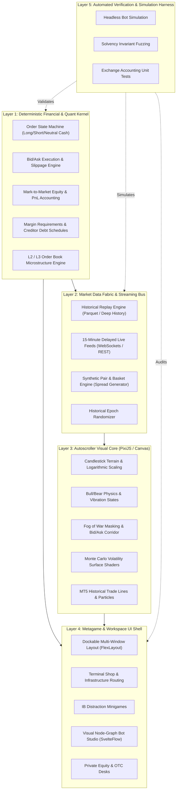

# 🏛️ BULLIMIA: System Architecture & Technology Blueprint

> **Engineering Standard**: Zero-Patchwork, Decoupled Modularity, Institutional Rigor  
> **Target Progression**: Phase 1 Arcade ($10K) $\rightarrow$ Phase 4 Institutional Empire ($100M+)

---

## 1. Executive Strategy & Architectural Mandate

Bullimia began as a gamified binary-options rhythm autoscroller on historical candlestick terrain. The long-term vision transforms this core into a deep quantitative trading simulation spanning multi-window docking, synthetic basket pair generation, visual node-graph bot engineering, 15-minute delayed live market feeds, L2/L3 order book microstructure, debt restructuring, and OTC/PE private equity operations.

To build this expansive vision without component rushing, architectural degradation, or patchworked technical debt, the system requires:
1. **A purpose-built technology stack** capable of rendering both high-speed 60–120 FPS 2D canvas/shaders and complex, responsive financial docking layouts.
2. **A strictly decoupled 5-layer modular architecture** where financial accounting, market data ingestion, autoscroller rendering, metagame workspace UI, and automated verification are cleanly isolated.
3. **An Autonomous Overseer Agent (`bullimia-architect`)** to enforce architectural standards, conduct modular code reviews, and guarantee that financial invariants are never compromised.

---

## 2. Technology Stack & Engine Evaluation

| Dimension | Option A: Pygame-CE (Python) | Option B: Tauri 2.0 + PixiJS + Svelte/React (Recommended) | Option C: Godot 4 (C# / GDScript) |
| :--- | :--- | :--- | :--- |
| **2D Autoscroller & Particles** | Native SDL2 surface rendering; adequate for Phase 1 demo. Struggles with complex multi-pass shaders and high object counts. | **Hardware-accelerated WebGL / WebGPU (PixiJS)**; renders 50,000+ candles, fluid particle systems, and Monte Carlo curves at 120 FPS. | Native 2D engine with excellent 2D shaders, particle systems, and camera controls. |
| **Multi-Window Docking & Layouts** | ❌ **Extremely brittle**. Pygame has no native docking layout manager. Building split panes and responsive tiles requires massive custom UI code. | 🏆 **Native Excellence**. Standard financial desktop stacks (`FlexLayout`, `GoldenLayout`, Tailwind CSS) provide seamless TradingView/Bloomberg-style docking. | Good UI node tree (`SplitContainer`, `TabContainer`), but less adaptable to dynamic, web-like financial dashboards. |
| **Visual Node-Graph Bot Studio (Phase 3)** | ❌ **High patchwork risk**. Writing an interactive node-graph flowchart editor from scratch in Pygame is a massive maintenance burden. | 🏆 **Turnkey Institutional Quality**. Leverages battle-tested visual graph engines (`SvelteFlow`, `ReactFlow`, `LiteGraph.js`) with drag-and-drop math blocks. | Native `GraphEdit` / `GraphNode` built into Godot; very capable for visual node editors. |
| **Market Data & Delayed Feeds** | Python `asyncio` / threads; solid, but thread-locking with GIL during heavy rendering. | 🏆 **High Concurrency**. WebSockets, Web Workers, and native Rust backend actors in Tauri provide non-blocking multi-asset streaming. | WebSockets supported via GDScript/C#, but financial data parsing libraries are sparse compared to JS/Python/Rust. |
| **Desktop Distribution & Performance** | PyInstaller bundles are large (~100MB+), slow startup, vulnerable to platform DLL conflicts. | 🏆 **Lightweight & Fast**. Tauri compiles to native C++/Rust binary with tiny footprint (<15MB), near-instant launch, and minimal memory usage. | Compact export binaries (~40MB), excellent runtime performance. |

### Architectural Verdict
- **Pygame** was the ideal prototyping platform to validate the core loop, logarithmic scaling, and Fog of War dynamics in Phase 1.
- For **Phases 2 through 4**, forcing complex financial docking, node-graph canvases, and multi-venue streaming into Pygame would inevitably create a patchworked, unmaintainable codebase.
- **The definitive foundation is Tauri 2.0 + PixiJS (Autoscroller Engine) + Svelte/React (Financial Docking & Bot Studio) + Python/Rust (Deterministic Financial Engine)**. This is the exact modern architecture powering contemporary institutional trading platforms (e.g., TradingView Desktop, IBKR Desktop, OpenFin).

---

## 3. The 5-Layer Decoupled Architecture

### Layer 1: Deterministic Financial & Quant Kernel (Zero-Render Math Core)
- **Responsibility**: Pure mathematical state transitions. Operates entirely without graphics, DOM, or audio dependencies.
- **Components**:
  - `PositionManager`: Tracks lots, open price, side (Bull, Bear, Neutral Cash), mark-to-market floating equity, and realized PnL.
  - `ExecutionEngine`: Simulates Bid/Ask crossing, venue commission tables, slippage models, and order fill latencies.
  - `CreditFacility`: Handles margin calculations, debt balance, interest payment schedules post-$10M, and sovereign lines of credit post-$100M.
  - `OrderBookEngine`: Models L2 depth, iceberg orders, and liquidity cascade waterfalls.

### Layer 2: Market Data Fabric & Streaming Bus
- **Responsibility**: Abstracting market data sources so game modes switch seamlessly between historical epochs and live feeds.
- **Components**:
  - `HistoricalReplayAdapter`: Reads local Parquet/JSON historical records (NVDA, TSLA, BTC, SPY, EUR/USD, Gold) and drops players at random epochs.
  - `DelayedLiveFeedAdapter`: Streams 15-minute delayed market quotes for idle autotraders.
  - `SyntheticBasketGenerator`: Computes real-time synthetic spreads across multi-asset baskets ($P_{\text{basket}} = \sum w_i P_i$) and renders them as unified candlestick terrain.

### Layer 3: Autoscroller Visual Core
- **Responsibility**: Rendering the 60+ FPS rhythm platformer experience.
- **Components**:
  - `TerrainRenderer`: Volatility-calibrated logarithmic candlestick geometry and wick meshes.
  - `PlayerController`: Smooth interpolation, spacebar vibration charge mechanics, character state animations.
  - `FogOfWarSystem`: Obscures future candles, illuminates glowing bid/ask spread corridor, and projects cycling Monte Carlo volatility fans.
  - `ParticleFX`: Momentum bursts, cash sparkles, margin call alarms, and liquidations.

### Layer 4: Metagame & Workspace UI Shell
- **Responsibility**: Financial workspace management, menus, mini-games, and strategy tooling.
- **Components**:
  - `DockingManager`: Grid and floating split-window workspace management.
  - `BotStudio`: Interactive visual node-canvas for building rule-based and stochastic trading bots.
  - `MinigameSubsystem`: Standalone cognitive distraction puzzles (pitchbooks, audit checks) running alongside live position charts.
  - `TerminalShop`: Licensing, exchange colocation, venue routing, and prime brokerage expansion.

### Layer 5: Automated Verification & Simulation Harness
- **Responsibility**: Preventing regressions, validating financial invariants, and stress-testing balance.
- **Components**:
  - `SolvencyFuzzer`: Runs headless trading loops under violent flash crashes to ensure margin, interest, and credit calculations never generate NaN or corrupt balances.
  - `EndToEndSuite`: Headless browser/CLI test runners verifying seamless asset switching, order execution, and UI persistence.

---

## 4. The "Zero-Patchwork" Quality Protocol

To guarantee that components are never rushed or poorly integrated, all feature development follows a strict four-stage gate:

1. **Gate 1: Mathematical Specification & Interface Design**
   - The data contract, mathematical formulas, and type interfaces are established before any code is written.
   - Example: For multi-asset basket trading, define exact weight normalization and synthetic tick generation formulas first.
2. **Gate 2: Headless Kernel Implementation & Invariant Verification**
   - Core financial logic is implemented in the pure math kernel and verified against unit test suites before connecting to the visual canvas.
3. **Gate 3: Visual & UX Integration**
   - UI and graphics layers are bound to the kernel via reactive subscriptions or event buses, ensuring rendering never modifies financial state directly.
4. **Gate 4: End-to-End Regression & Visual Polish**
   - Headless verification and visual inspection confirm zero performance drops, no frame pacing hiccups, and clean error handling.

---

## 5. Overseer Agent Specification: `bullimia-architect`

To keep the full vision in focus across sessions, a dedicated subagent type has been created: **`bullimia-architect`**.

### Role & Responsibilities:
- **Vision Custodian**: Maintains strict alignment with `GRAND_VISION_ROADMAP.md` and ensures every task serves the long-term progression.
- **Architectural Auditor**: Reviews code proposals against the 5-layer decoupled architecture to reject monolithic spaghetti or patchwork shortcuts.
- **Quant Specialist**: Validates that all market mechanics (slippage, spreads, commissions, margin calls, interest schedules, order book depth) reflect genuine quantitative and financial realities.
- **Systematic Planner**: Breaks down complex epics (e.g., Phase 2 Multi-Window Docking, Phase 3 Bot Studio) into atomic, testable increments.

---

## 6. Migration & Phase 2 Roadmap Readiness

When the user gives the instruction to commence Phase 2, the execution path is clearly mapped:
1. **Repository Structure Setup**: Scaffold the modular client-core directory structure.
2. **Phase 2.1: Advanced Tactical Controls**: Implement `SPACE + ESC` Neutral Cash Flattening and Time Dilation (0.5x, 1x, 2x, 5x).
3. **Phase 2.2: Dockable Multi-Window Layout**: Enable multi-chart split panes for concurrent asset trading.
4. **Phase 2.3: Synthetic Basket Pairs**: Implement real-time basket math and synthetic candlestick generation.
5. **Phase 2.4: Terminal Shop & Venue Routing**: Build infrastructure upgrades and ECN/Dark Pool selection.
6. **Phase 2.5: IB Distraction Minigames**: Implement cognitive micro-puzzles with scaled cash payouts.
